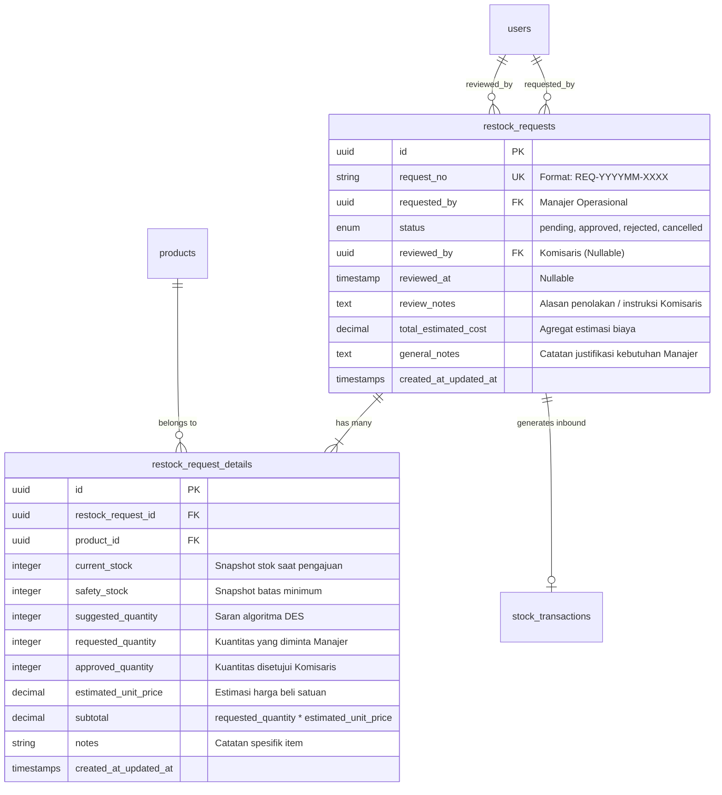

# Blueprint Arsitektur Modul 5: Multi-Item Restock Approval

**Dokumen Spesifikasi Teknis & Bisnis**  
Proyek PBL Kelompok 1 - SIB 3C | Jurusan Teknologi Informasi, Politeknik Negeri Malang  
Status Rencana: **Terkonfirmasi & Siap Implementasi pada Fase 3 (Pasca UTS / Minggu ke-12)**

---

## 1. Latar Belakang & Rasionalisasi Desain
Sistem SIPALING menggunakan pola transaksi multi-item untuk mutasi barang masuk (`inbound`) dan keluar (`outbound`) melalui tabel `stock_transactions` dan `stock_transaction_details`. 

Untuk menjaga keseragaman arsitektur (*architectural consistency*) dan mencerminkan proses bisnis riil logistik distributor, pengajuan restock dari Manajer Operasional kepada Komisaris dirancang menggunakan pola **Header-Detail (Multi-Item Purchase Requisition)**.

### Keunggulan Bisnis:
1. **Efisiensi Otorisasi Komisaris**: Komisaris cukup meninjau 1 berkas pengadaan berkala (misal: pengadaan mingguan berisi 15 produk kritis) dan melakukan 1x verifikasi keputusan (*Single Sign-off*) ketimbang menyetujui 15 tiket terpisah.
2. **Kalkulasi Anggaran Agregat**: Komisaris dapat melihat total estimasi nilai rupiah pengadaan barang secara transparan sebelum memberi persetujuan.
3. **Closed-Loop Procurement Lifecycle**: Pengajuan restock yang telah disetujui Komisaris dapat langsung diubah menjadi Draf Transaksi Masuk (*Inbound Draft*) tanpa input data berulang oleh Staf Gudang.

---

## 2. Skema Relasi Basis Data (MySQL + UUID v4)

---

## 3. Alur Kerja Alur Persetujuan (Workflow Lifecycle)

1. **Inisiasi & Rekomendasi**:
   - Manajer Operasional membuka `Analytics/Index.vue` atau `Restock/Create.vue`.
   - Sistem menandai produk-produk dengan status `RESTOCK_URGENT` berdasarkan kalkulasi Holt's Double Exponential Smoothing.
   - Manajer memilih produk-produk yang ingin diajukan, menyesuaikan jumlah kebutuhan, dan menekan **"Kirim Usulan Pengadaan"**.
2. **Pengarsipan Draf**:
   - Sistem mencatat header ke `restock_requests` (status: `pending`) dan seluruh rincian ke `restock_request_details` dalam transaksi atomik database (`DB::transaction`).
   - Tercatat otomatis ke `activity_log`.
3. **Evaluasi Komisaris**:
   - Komisaris mengakses `Restock/Approval.vue`.
   - Komisaris dapat:
     - **Setujui Penuh (Approve)**: Menyetujui kuantitas sesuai permintaan.
     - **Tolak (Reject)**: Wajib melampirkan alasan penolakan pada `review_notes`.
4. **Eksekusi Inbound (Handover Gudang)**:
   - Pengajuan berstatus `approved` menampilkan tombol **"Terbitkan Transaksi Masuk (Inbound)"** untuk Staf Gudang saat barang fisik tiba di gudang.
