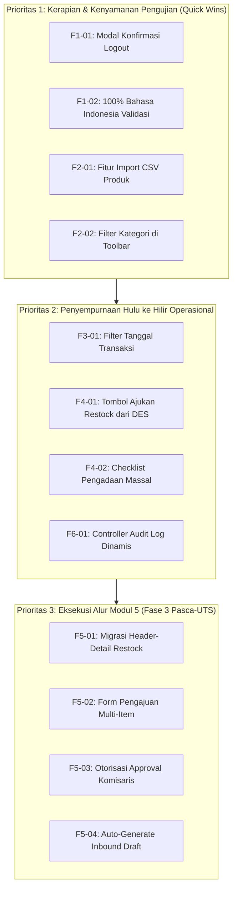

# SIPALING — Matriks Rekomendasi Penyempurnaan Fitur (Hulu ke Hilir)

**Dokumen Analisis Fitur & Peningkatan Kualitas Sistem**  
Proyek PBL Kelompok 1 - SIB 3C | Jurusan Teknologi Informasi, Politeknik Negeri Malang  
Status: **Siap Dieksekusi Secara Bertahap (Tanpa Penambahan Modul Baru / Anti Scope-Creep)**

---

## 1. Latar Belakang & Prinsip Rekomendasi
Meskipun arsitektur fondasi modul SIPALING telah selesai dibangun (~79%), terdapat detail-detail operasional mikro, konsistensi bahasa, perlindungan interaksi pengguna, serta kebutuhan efisiensi pengujian massal (seperti impor data) yang belum terdefinisi secara presisi.

Dokumen ini memetakan seluruh penyempurnaan fitur yang diperlukan secara **Hulu ke Hilir (End-to-End Lifecycle)** di dalam **6 modul yang sudah ada**, tanpa menambah modul baru agar terhindar dari *scope creep*.

---

## 2. Matriks Penyempurnaan Fitur Hulu ke Hilir

### A. Modul 1: Autentikasi, Profil & Keamanan Akses (RBAC)
Fokus: Konsistensi bahasa pesan sistem, pencegahan ketidaksengajaan keluar sesi, dan proteksi akun.

| ID Fitur | Area / Lokasi File | Masalah Saat Ini | Spesifikasi Fitur yang Direkomendasikan | Dampak & Nilai Tambah |
| :---: | :--- | :--- | :--- | :--- |
| **F1-01** | `AuthenticatedLayout.vue` & `AppSidebar.vue` | Tombol **Keluar (Logout)** jika diklik langsung mengeksekusi POST `/logout` tanpa dialog peringatan. Pengguna berisiko kehilangan draf input jika tidak sengaja menekan tombol. | Menambahkan **Modal Konfirmasi Keluar (*Safety Logout Dialog*)** menggunakan komponen Shadcn Dialog: *"Apakah Anda yakin ingin keluar dari sistem SIPALING?"* dengan tombol Batal dan Konfirmasi Keluar. | Mencegah *accidental session termination* dan melindungi data draf operasional gudang yang sedang diisi. |
| **F1-02** | `lang/id/validation.php` & Form Requests | Masih terdapat pesan validasi bawaan Laravel yang berbahasa Inggris (seperti pada `ProfileController`, aturan `current_password`, dan aturan bawaan unhandled). | Menerbitkan berkas lokalisasi resmi bahasa Indonesia (`lang/id/validation.php` dan `lang/id.json`) serta menyetel `config/app.php` `'locale' => 'id'`. Seluruh pesan error, required, min, max, unique, dan confirmed 100% berbahasa Indonesia baku. | Menghilangkan inkonsistensi bilingual (ID-EN), antarmuka terlihat profesional dan seragam. |
| **F1-03** | `UserController.php` & `User/Index.vue` | Admin belum bisa melakukan reset password darurat untuk staf gudang yang lupa sandi dan tidak memiliki akses ke inbox email OTP. | Tombol aksi *"Kirim Ulang Undangan / Reset Kata Sandi Sementara"* oleh Admin/Komisaris pada tabel pengguna, dengan masa berlaku 24 jam. | Menjamin kelancaran operasional jika terjadi kendala pada server SMTP email lokal saat pengujian/demo. |

---

### B. Modul 2: Katalog & Master Data Inventaris
Fokus: Efisiensi input data skala besar untuk pengujian akhir semester, pencarian multi-kategori, dan ekspor data.

| ID Fitur | Area / Lokasi File | Masalah Saat Ini | Spesifikasi Fitur yang Direkomendasikan | Dampak & Nilai Tambah |
| :---: | :--- | :--- | :--- | :--- |
| **F2-01** | `ProductController.php` & `InventoryToolbar.vue` | Input data barang hanya bisa dilakukan satu per satu melalui modal manual. Jika dosen meminta pengujian 100–500 data produk baru, input manual akan memakan waktu berjam-jam. | **Fitur Import Produk dari Berkas CSV (*Bulk CSV Import*)**: 1. Tombol *Import CSV* pada toolbar. 2. Modal unggah berkas `.csv` dengan validasi header (`sku, name, category, unit, unit_price, current_stock, minimum_stock`). 3. Tombol unduh *Template CSV Contoh*. 4. Ringkasan hasil impor (Jumlah berhasil, jumlah gagal karena SKU duplikat). | Mempercepat penyiapan data uji akhir semester dalam hitungan detik tanpa membebani anggota tim. |
| **F2-02** | `InventoryToolbar.vue` & `ProductController.php` | Toolbar inventaris hanya memiliki filter tab status (*Semua, Aman, Perlu Restock*). Belum ada filter berdasarkan Kategori barang. | Menambahkan **Dropdown Filter Kategori** di samping bar pencarian teks, memungkinkan staf menyaring produk berdasarkan kategori spesifik (misal: *Komputer & Laptop*, *Peralatan Jaringan*). | Mempermudah penelusuran stok saat katalog barang sudah mencapai ratusan item. |
| **F2-03** | `ProductController.php` | Pengambilan produk pada `index()` mengambil seluruh baris data sekaligus (`->get()`) tanpa pembatasan paginasi server. | Menerapkan paginasi hybrid atau server-side pagination dengan parameter `per_page` (default 25/50/100 item) agar respon antarmuka tetap ringan saat data berjumlah ribuan. | Menghindari beban memori (*memory bottleneck*) browser dan server saat rendering ribuan data. |
| **F2-04** | `Inventory/Index.vue` & Controller | Belum ada fasilitas mengunduh daftar katalog barang fisik untuk pencocokan fisik rak gudang (*stock opname*). | Tombol **Export Data Katalog ke CSV / Excel** yang mengunduh seluruh baris produk aktif beserta status stok riil dan nilai rupiah inventaris. | Mendukung operasional riil *stock opname* dan audit inventaris berkala. |

---

### C. Modul 3: Transaksi Mutasi Stok Harian (Inbound & Outbound)
Fokus: Filter riwayat mutasi lanjutan, peringatan ambang batas mutasi keluar, dan akses cepat struk fisik.

| ID Fitur | Area / Lokasi File | Masalah Saat Ini | Spesifikasi Fitur yang Direkomendasikan | Dampak & Nilai Tambah |
| :---: | :--- | :--- | :--- | :--- |
| **F3-01** | `Transactions/Index.vue` & `StockTransactionController.php` | Halaman riwayat transaksi hanya memiliki filter pencarian teks dan tab tipe (*Semua, Masuk, Keluar*). Tidak ada filter rentang tanggal. | Menambahkan **Filter Rentang Tanggal Transaksi (*Date Range Filter: Dari Tanggal s.d. Tanggal*)** dan filter pihak terkait (*Supplier / Customer*). | Memungkinkan Staf Gudang dan Auditor melacak transaksi pada periode audit tertentu secara akurat. |
| **F3-02** | `OutboundCreate.vue` | Saat Staf Gudang mengeluarkan barang dalam jumlah yang membuat sisa stok menyentuh atau berada di bawah *Safety Stock*, sistem belum memberi peringatan visual sebelum klik Simpan. | Menampilkan **Badge Peringatan Interaktif (*Low Stock Warning Toast / Callout*)** saat baris barang yang diinput akan menyisakan stok $\le \text{Minimum Stock}$ pasca-transaksi. | Mencegah pengeluaran barang tanpa menyadari bahwa barang tersebut akan langsung berstatus kritis. |
| **F3-03** | `Transactions/Index.vue` | Tombol cetak struk PDF hanya dapat diakses dengan membuka modal detail transaksi terlebih dahulu. | Menambahkan tombol aksi cepat ikon **Printer / Unduh PDF Langsung** pada setiap baris tabel riwayat transaksi tanpa harus membuka dialog detail. | Meningkatkan kecepatan kerja staf gudang saat mencetak berkas surat jalan / serah terima barang secara massal. |
| **F3-04** | `InboundCreate.vue` & `OutboundCreate.vue` | Input harga satuan belum memiliki format pemisah ribuan otomatis (rupiah), sehingga rentan salah input digit angka nol. | Menerapkan format masker mata uang otomatis (misal: otomatis terformat `Rp 150.000` saat diketik) dengan nilai numerik bersih yang dikirim ke backend. | Menghilangkan risiko kesalahan finansial (*typo digit*) pada pencatatan nilai barang inventaris. |

---

### D. Modul 4: Analitik & Mesin Peramalan DES Holt
Fokus: Jembatan integrasi usulan pengadaan, pemilihan barang kritis massal, dan simulasi interaktif.

| ID Fitur | Area / Lokasi File | Masalah Saat Ini | Spesifikasi Fitur yang Direkomendasikan | Dampak & Nilai Tambah |
| :---: | :--- | :--- | :--- | :--- |
| **F4-01** | `Analytics/Index.vue` | Pada tabel *Ringkasan Rekomendasi Pengadaan*, hanya ada tombol *"Simulasi"* untuk memuat grafik. Belum ada tombol aksi untuk menindaklanjuti barang berstatus `RESTOCK_URGENT`. | Menambahkan tombol aksi **"Ajukan Restock"** pada baris barang kritis yang otomatis mengarahkan Manajer ke formulir pengajuan restock dengan kuantitas saran terisi otomatis. | Menutup siklus (*closed-loop*) dari pembacaan data prediksi menjadi tindakan operasional nyata. |
| **F4-02** | `Analytics/Index.vue` | Manajer harus memproses barang satu per satu jika terdapat 10 barang yang memerlukan restock mendesak. | Menambahkan fitur **Kotak Centang Massal (*Bulk Checkbox Selection*)** dan tombol *"Ajukan Pengadaan Sekaligus (Batch)"* untuk seluruh barang yang ditandai. | Menghemat waktu Manajer Operasional dalam menyusun berkas pengadaan multi-item mingguan. |
| **F4-03** | `AnalyticsController.php` & `Index.vue` | Nilai akurasi MAPE dan RMSE saat ini dihitung per produk yang dipilih, belum ada kartu ringkasan rata-rata akurasi sistem secara keseluruhan. | Menambahkan kartu KPI ringkasan pada bagian atas dasbor: **"Rata-rata Akurasi Model Katalog"** (Average MAPE & Mean RMSE seluruh produk aktif). | Memberikan keyakinan instan kepada Manajer dan Dosen mengenai performa keandalan model DES secara sistemik. |

---

### E. Modul 5: Alur Persetujuan Pengadaan Multi-Item (Restock Approval Workflow)
Fokus: Implementasi sepasang tabel Header-Detail, alur keputusan Komisaris, dan konversi otomatis ke transaksi Inbound.

| ID Fitur | Area / Lokasi File | Masalah Saat Ini | Spesifikasi Fitur yang Direkomendasikan | Dampak & Nilai Tambah |
| :---: | :--- | :--- | :--- | :--- |
| **F5-01** | `database/migrations` & Models | Backend modul restock saat ini masih berupa *placeholder* kosong (UI statis di `Restock/Index.vue` dan `Restock/Approval.vue`). | **Implementasi Migrasi & Model Header-Detail UUID v4**: • Tabel `restock_requests` (Header: nomor referensi `REQ-YYYYMM-XXXX`, pemohon, reviewer, status, total biaya estimasi). • Tabel `restock_request_details` (Detail: item produk, kuantitas saran DES, kuantitas diminta, estimasi harga satuan). | Membangun pondasi data pengadaan yang selaras dengan pola transaksi multi-item gudang. |
| **F5-02** | `Restock/Create.vue` & Controller | Belum ada form khusus bagi Manajer Operasional untuk merangkai usulan pengadaan barang multi-item di luar dasbor analitik. | Membangun halaman formulir pengajuan restock multi-item dinamis (tambah/hapus baris barang, pencarian produk, kalkulasi total biaya otomatis). | Memberikan keleluasaan bagi Manajer untuk mengajukan pengadaan reguler maupun darurat secara mandiri. |
| **F5-03** | `Restock/Approval.vue` & Service | Belum ada backend logika persetujuan atau penolakan dengan validasi peran Komisaris. | **Dasbor Otorisasi Komisaris (*Single Sign-off*)**: 1. Tinjauan rincian berkas dan total estimasi anggaran. 2. Tombol *Setujui (Approve)* yang mengunci berkas. 3. Tombol *Tolak (Reject)* dengan dialog **Wajib Mengisi Alasan Penolakan (*Review Notes*)**. | Menjamin transparansi tata kelola pengadaan barang dan mencegah keputusan sepihak tanpa justifikasi. |
| **F5-04** | `RestockRequestService.php` | Berkas pengadaan yang disetujui berisiko terhenti tanpa realisasi fisik barang masuk di gudang. | **Konversi Otomatis ke Draf Transaksi Inbound (*Auto-Generate Inbound*)**: Berkas restock yang berstatus `APPROVED` menampilkan tombol aksi bagi Staf Gudang: *"Terbitkan Transaksi Masuk (Inbound)"*, yang otomatis memindahkan rincian barang ke form mutasi masuk tanpa ketik ulang. | Menghilangkan duplikasi input data dan menjamin barang yang dibeli sesuai dengan barang yang disetujui Komisaris. |

---

### F. Modul 6: Jejak Audit Trail & Investigasi Forensik Log
Fokus: Filter penelusuran riwayat multi-parameter, ekspor laporan audit, dan jaminan keamanan data log permanen.

| ID Fitur | Area / Lokasi File | Masalah Saat Ini | Spesifikasi Fitur yang Direkomendasikan | Dampak & Nilai Tambah |
| :---: | :--- | :--- | :--- | :--- |
| **F6-01** | `routes/web.php` & `AuditController.php` | Rute `/audit` masih menggunakan *Closure* sederhana (`ActivityLog::latest()->paginate(15)`) tanpa controller, sehingga fungsi pencarian dan filter di antarmuka tidak berjalan di server. | Membuat `AuditLogController.php` dengan kueri pencarian dinamis berbasis: kata kunci teks, modul (`inventory, users, transactions`), tipe aksi (`created, updated, deleted, inbound, outbound`), serta rentang tanggal. | Menjadikan portal investigasi audit berfungsi penuh secara fungsional. |
| **F6-02** | `Audit/Index.vue` & Controller | Auditor Internal belum dapat mengekspor rekam jejak investigasi ke berkas dokumen untuk keperluan lampiran pelaporan resmi. | Menambahkan tombol **Export Audit Log ke CSV dan Cetak Laporan PDF Ringkas** yang memuat nomor bukti, aktor, alamat IP, stempel waktu, dan ringkasan mutasi. | Memenuhi kebutuhan kepatuhan tata kelola (*compliance standard*) dan mempermudah presentasi uji forensik di hadapan dosen. |
| **F6-03** | `app/Models/ActivityLog.php` | Model `ActivityLog` masih mewarisi metode bawaan Eloquent yang memungkinkan operasi `update()` atau `delete()`. | Melakukan *override* pada model `ActivityLog` dengan melempar *Exception* jika ada percobaan eksekusi `update()` atau `delete()` melalui kode program (*Tamper-Proof Guarantee*). | Menjamin rekam jejak audit bersifat mutlak *append-only* (tidak dapat dimanipulasi bahkan oleh administrator). |

---

## 3. Rangkuman Urutan Pengerjaan Rekomendasi (Prioritas Eksekusi)

---

Dokumen ini menjadi panduan pembagian tugas internal bagi rekan tim untuk menyempurnakan fitur-fitur teknis tanpa risiko *scope creep*.
